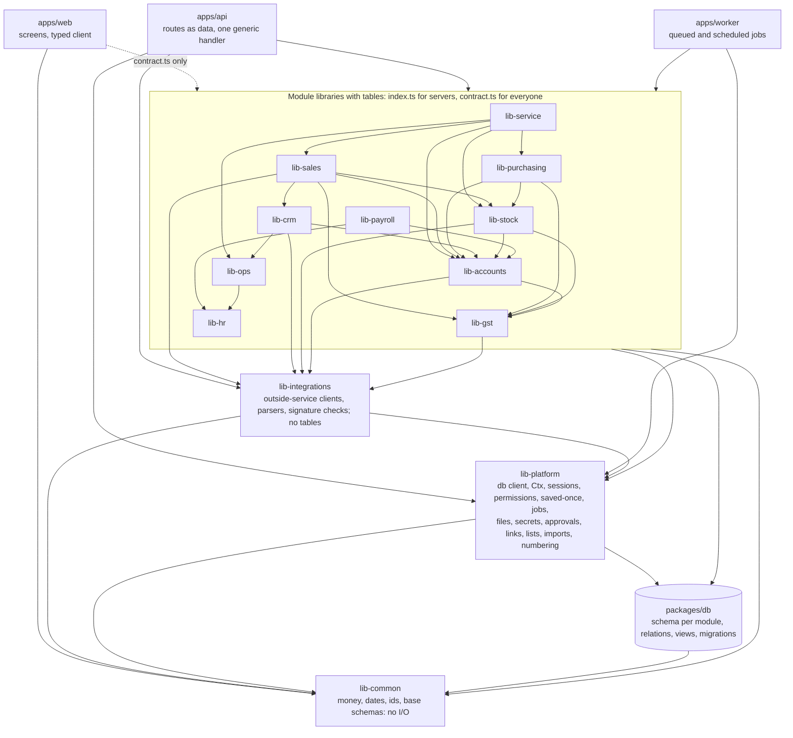

# RadCore v2: packages and who calls whom

One page. The rules behind it are in [ADR-001](adr/001-layers.md). An arrow means "may import". Every arrow
points down a rank, so there are no cycles.

Read the module arrows as "calls the service of". For example, lib-sales calls lib-stock to move goods and
lib-accounts to post the journal. apps/api imports lib-integrations only to hand a provider's signature check to
the webhook intake (ADR-001 §8a).

Where the rules are, rather than repeated here:

- What may import what, and what never may: [ADR-001 §4](adr/001-layers.md#4-who-may-depend-on-whom) and the
  [Enforcement table](adr/001-layers.md#enforcement-for-m0-07-to-add-m0-08-to-run-in-ci).
- Who writes and reads each table: [§5](adr/001-layers.md#5-one-owner-per-table).
- The path of one request, the webhook lane and saved-once:
  [§6](adr/001-layers.md#6-routes-declared-as-data-one-generic-handler).
- Who a request runs as: [§6a](adr/001-layers.md#6a-who-a-request-runs-as).
