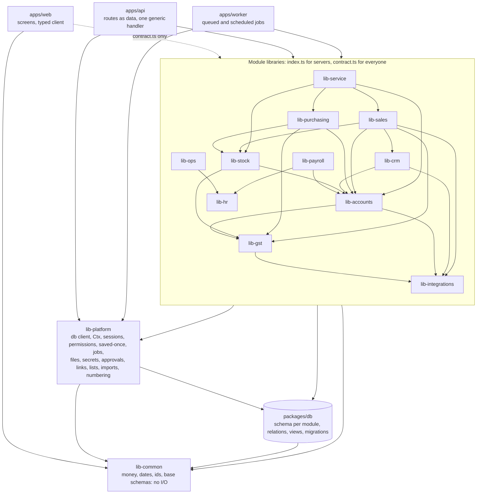

# RadCore v2: packages and who calls whom

One page. The rules behind it are in [ADR-001](adr/001-layers.md). An arrow means "may import". Every arrow
points down a rank, so there are no cycles.



Read the module arrows as "calls the service of". For example, lib-sales calls lib-stock to move goods and
lib-accounts to post the journal. lib-integrations is the one module library that never touches packages/db.

## Never

| From | Never imports | Why |
|---|---|---|
| apps/web | lib-platform, packages/db, a library's `index.ts`, Node built-ins | server code must not reach the browser bundle |
| apps/api, apps/worker | packages/db | the database is reached through services and lib-platform's transaction |
| any `packages/*` | Express, Next, anything in `apps/` | the worker must run any service without the web layer (RC-175) |
| any library | another module's tables in `packages/db/src/<module>/` | one owner writes each table; others read by relation or view |
| a `contract.ts` | db, lib-platform, services | the web imports it |
| a route or job file | anything but contracts, library entries, `defineRoute` / `defineJob` | no rule lives in a route |

## One request

```
apps/web ── typed client (from lib-x/contract) ──► apps/api generic handler
   guards ─► session ─► parse input ─► route permission ─► saved-once
   ─► transaction (timeouts) ─► lib-x service(ctx, input) ─► record-scope check, rules, other libraries' services
   ─► packages/db (own tables; relations and views for others) ─► commit ─► output as declared
```
